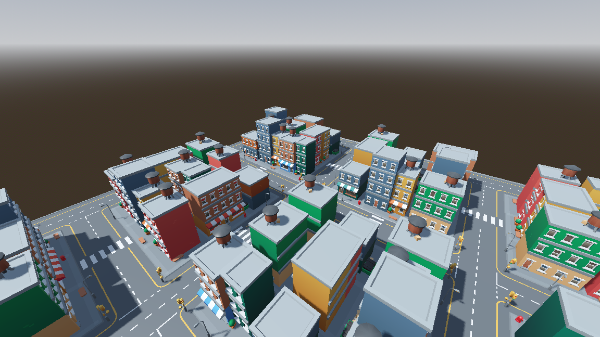

# IA-Coches-RL

Proyecto de estudio: aprender Reinforcement Learning (RL) haciendo que un coche 2D aprenda a conducir solo.

- **Fase 1** (Python/pygame): un coche 2D aprende a conducir con PPO en pistas aleatorias.
- **Fase 2** (Godot 4.7): una ciudad 3D con el pack KayKit City Builder Bits (CC0) donde el coche aprende a ir a una meta (Godot RL Agents).

## Instalación

```bash
python3.11 -m venv .venv
source .venv/bin/activate
pip install -r requirements.txt
```

## Uso

```bash
python play.py --random   # coche sin entrenar (acciones al azar)
python train.py           # entrena (200k pasos, unos minutos en CPU)
python evaluate.py        # compara numéricamente azar vs. entrenado
python play.py            # ver al coche entrenado
```

## Archivos (en el orden recomendado para leerlos)

| Archivo | Qué es |
|---|---|
| `car_env.py` | El entorno v2: pistas con curvas **distintas en cada episodio**, sensores, **recompensa**. Lo más importante. |
| `car_env_ring.py` | Entorno v1 (anillo fijo), conservado para comparar. Gráfica: `training_curve_ring.png`. |
| `train.py` | Entrenamiento con PPO (Stable-Baselines3). |
| `evaluate.py` | Mide vueltas medias: azar vs. modelo. |
| `play.py` | Visualiza con pygame. |
| `plot.py` | Gráfica de aprendizaje (`training_curve.png`) a partir de `logs/episodes.csv`. |

## Conceptos clave

- **Observación:** 7 rayos de distancia a la pared + velocidad (todo normalizado 0..1).
- **Acción:** [dirección, aceleración] continuas en -1..1.
- **Recompensa:** + por avanzar alrededor del circuito, −10 por chocar, −0.01 por paso.
- **PPO:** algoritmo que ajusta una red neuronal para maximizar la recompensa acumulada.

## Fase 2: ciudad en Godot



Requiere Godot 4.7 (en este repo se usa `/Volumes/ack - ssd/Applications/Godot.app`; otra ruta con la variable `GODOT_PATH`).

```bash
python train_godot.py          # entrena 300k pasos (~2-3 min). Godot se lanza solo, sin ventana
python train_godot.py 800000   # más pasos
python play_godot.py           # abre Godot con ventana y el modelo entrenado conduciendo
godot --path godot             # (escena drive) conduces tú con las flechas; R = reiniciar
```

Qué hay dentro de `godot/`:

| Ruta | Qué es |
|---|---|
| `scenes/` | `city` (mapa), `world` (mapa + puntos de salida + grafo de calles), `drive` (1 coche tuyo), `train` (16 coches de IA + Sync), `watch` (3 coches con rayos). |
| `scripts/car.gd` | Coche cinemático (modelo de bicicleta): sensores, meta, recompensa. Es el equivalente a `car_env.py`. |
| `scripts/car_ai_controller.gd` | Conecta el coche con Godot RL Agents (observación, acción, fin de episodio). |
| `scripts/road_graph.gd` | Qué celdas son carretera y ruta más corta (BFS) hasta la meta. |
| `tools/build_*.gd` | Generan la MeshLibrary y las escenas (`godot --headless --path godot --script res://tools/build_city.gd`, luego `build_library`, `build_car`, `build_drive`). |
| `addons/godot_rl_agents/` | Plugin oficial (MIT) que habla con Python. |
| `models/car.onnx` | Último modelo exportado (+ `car.onnx.data`, deben ir juntos). |

El mapa se genera por código (`tools/build_city.gd`): retícula 13×13 de calles con curvas, cruces en T y en X, pasos de peatones, 81 edificios (cada uno mirando a su calle), semáforos y farolas.

### Observación, acción y recompensa en Godot

- **Observación (13):** 7 rayos de distancia + velocidad + dirección (seno, coseno) hacia las 2 próximas celdas de la ruta a la meta + distancia que queda por la ruta.
- **Acción:** `[dirección, aceleración]` en -1..1 (dirección +1 = derecha).
- **Recompensa:** ×1.5 por cada metro que se acerca a la meta *por la ruta*, +10 al llegar (aparece otra meta), −10 al chocar, −0.01 por paso.
- La meta se calcula con un BFS sobre las calles (no en línea recta, porque las manzanas están en medio).

### Resultados

Con `python train_godot.py 800000` (~6 min), evaluado en 200 episodios de 250 pasos:

- **6,9 metas por episodio** de media, y ningún episodio con 0 metas.
- **74,5 %** de los episodios terminan sin chocar; el 25,5 % acaba en choque.

Para medirlo fiable hay que leer `info["goals_reached"]` (lo expone `car_ai_controller.gd`). Ojo: Godot lee la info al principio de cada paso de IA, después de que el coche se haya reseteado, por eso el controlador guarda el valor en `finished_goals` al terminar el episodio.

### Cosas a saber

- `--speedup=20` acelera la simulación sin cambiar el `delta` de la física, así que lo aprendido vale en el juego normal.
- El plugin ejecuta ONNX dentro de Godot con C#: hace falta el **Godot .NET**. Con el Godot estándar el modelo se ejecuta desde Python (`play_godot.py`).
- Las escenas `.tscn` de `world`/`train`/`watch`/`drive` están generadas: si cambias un script de `tools/`, vuelve a ejecutarlo.

## Ideas para experimentar

1. Cambia la recompensa (p. ej. quita el −0.01) y observa cómo cambia el comportamiento.
2. Prueba `python train.py 50000` vs `1000000` y compara con `evaluate.py`.
3. Cambia `N_RAYS` o el ancho de la pista.
4. Añade obstáculos u otros coches.
